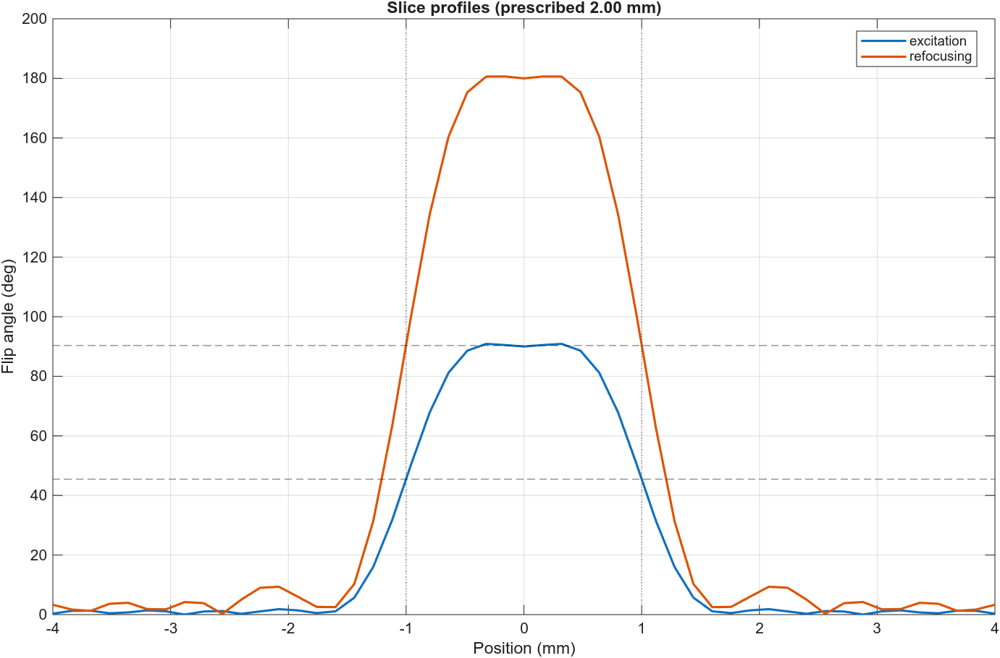
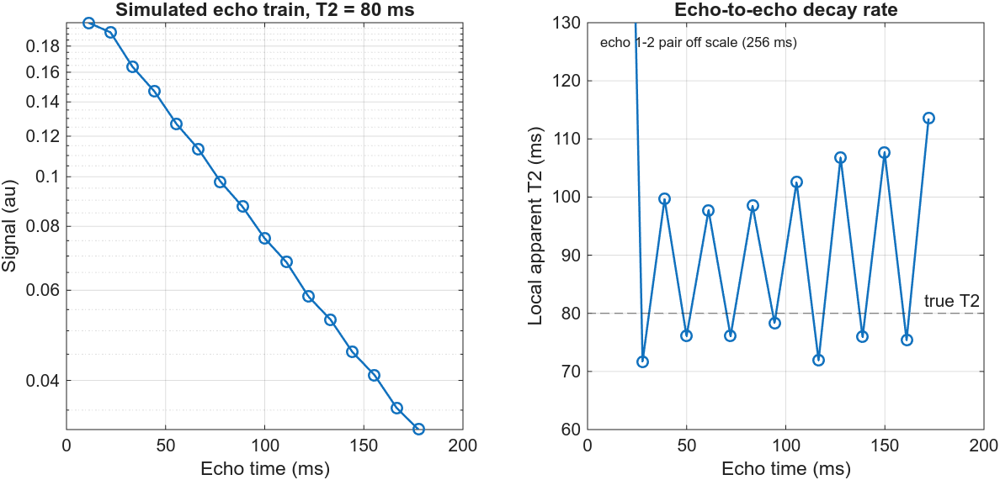
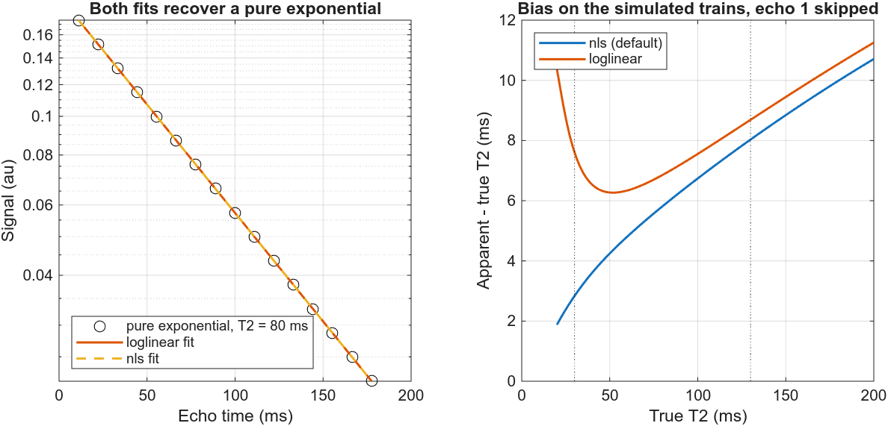
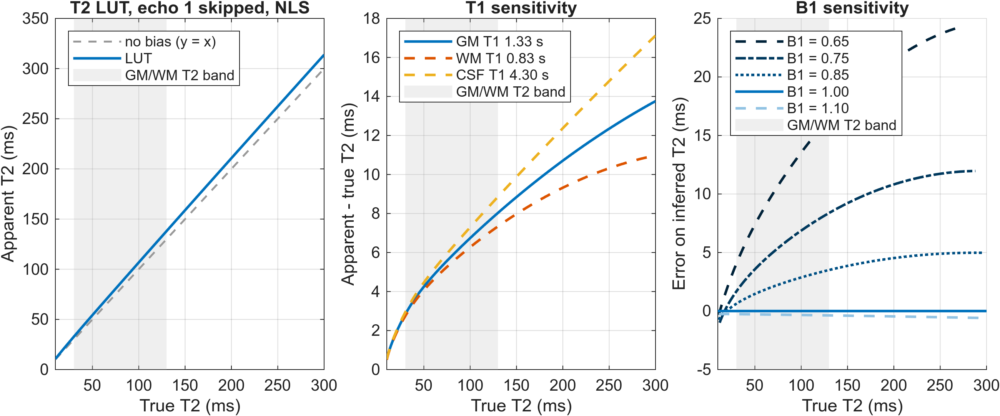
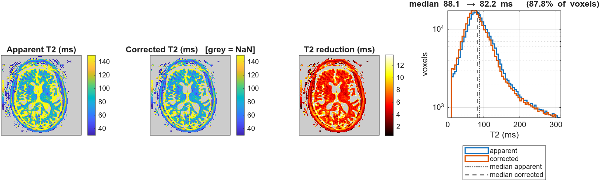

# Stimulated-echo T2 LUT correction

This toolbox creates a Look-Up-Table based on sequence parameters and slice profile using EPG simulations for a range of plausible T2 values in the human brain at 3T. 

This toolbox was developed to correct for T2 maps reconstructed with the GRAPPATINI Siemens sequence: the raw signal is not available and the T2 map is contaminated by stimulated echo times that cannot be corrected with a standard StimFit approach ([Lebel and Wilman, MRM 2010](https://doi.org/10.1002/mrm.22487)). 

Note on assumptions: 
- This approach has a known bias induced by unknown B1 inhomogeneity. B1 is set to its nominal value of 1, meaning the pulses are assumed to deliver exactly the flip angles the protocol prescribes; no B1 map is available for this protocol. Nominal is not a maximum: at 3T the transmit calibration makes the flip angle correct on average over the head, so the delivered angle sits above 1 in some regions and below it in others. The bias is systematic and always positive below 1, meaning the corrected T2 remains overestimated where the delivered flip angle falls short. Simulations indicate an error on the inferred T2 of about +1 to +3 ms for a typical B1 of 0.85, rising to +2 to +5 ms at B1 = 0.80 and +6 to +16 ms in regions where B1 falls to 0.65. The error increases with T2. The response either side of the nominal is strongly asymmetric, so the direction of the error matters as much as its size: over the 30-130 ms band, B1 = 1.05 or 1.10 costs at most 0.4 ms (and in the opposite direction, a slight over-correction), and even B1 = 1.30 stays under 3 ms, against +3.5 ms at B1 = 0.85 and +16.5 ms at B1 = 0.65. This represents the largest source of uncertainty for T2 > 50ms. Correcting this bias would require an acquired B1 map and a LUT with an additional B1 dimension. Note also that StimFit fits a single flip-angle scaling, so its "B1" absorbs simulated-slice-profile and gradient-calibration error alongside true transmit inhomogeneity. A value fitted that way describes the acquisition it came from rather than the transmit field alone, which is why 0.85 is quoted here as an indication of scale and this LUT still assumes B1=1.
- The range of T2 values simulated for this LUT table is 10 to 300ms, which is wider than the grey matter (GM) and white matter (WM) tissue target for T2 correction. Within this wider range, long T2 voxels (e.g. cerebrospinal fluid, CSF) are included in the LUT correction at the cost of T1 assumptions (see T1 assumptions below). The bias it removes runs from +0.5ms at T2=10ms to +13.8ms at T2=300ms and +2.8 to +8ms within the 30-130ms band for GM and WM tissue. This range may not match all field strength and tissue and may require adjustments.
- The "GRAPPATINI" mode assumes that the monoexponential fit applied during reconstruction skipped the first echo of the multi echo train length and was reconstructed from complex data, hence the simulation do not account for a noise floor. Applying the model to other sequence schemes may require further adjustments.
- The slice profile needs to be provided or simulated using proprietary waveform information as per [StimFit](https://github.com/usc-mrel/StimFit/tree/main).
- A single T1 value is considered per LUT file (default is grey matter T1=1.33s according to [Hagiwara et al. 2021](https://doi.org/10.1097/RLI.0000000000000720)). Stimulated echoes are contaminated by T1 relaxation: magnetization is stored along the longitudinal axis between refocusing pulses, where it relaxes according to T1 rather than T2. The value of T1 therefore scales the bias corrected by this LUT. The default LUT is scoped to **grey matter**, and applying it to white matter (T1 ≈ 0.83 s at 3T) carries a known bias measured at less than 0.7ms across the 30-130ms tissue band: The WM and GM LUTs differ by *at most* 0.69ms; and correcting WM using a GM LUT corrects by 0.08 to 0.66ms too low compared to a WM specific LUT. LUT files for different T1 may be generated by specifying T1 in the `build_opt_from_protocol` call. Two LUT files may be built and each applied within its own segmentation label. 
- Beyond the 30-130ms tissue band, the T1 scope has a higher impact. At true T2=300ms, applying a GM LUT to voxels with CSF T1 (4.3s) returns a T2 value too high by up to 3.2ms and a WM tissue T1 with a GM LUT would return a value too low by up to 2.7ms. Long T2 voxels are therefore corrected, but under a T1 value that does not describe them, the corrected values should be read as indicative rather than quantitative.
- Inherited from the StimFit implementation: background field gradients are neglected, slice profiles are simulated with the slice-select gradient alone. Consequences: approximations will be weakest where susceptibility gradients are strong (orbitofrontal and temporal lobes).

## Dependencies
- [StimFit](https://github.com/usc-mrel/StimFit): provides `StimFit_optset`, `readRF_Siemens`, `getRF`, `pulse_sim` and `FSEsig`. 
- MATLAB. Developed and tested on R2025a; the `arguments` block used by `build_opt_from_protocol.m` requires R2019b or later.
- MATLAB Optimization Toolbox: provides `lsqnonlin` required by StimFit (`StimFit_optset`) and for monoexponential fitting.  

**Which StimFit version** 

Use the `fix/complex-tip-angle` branch ([luciechalet/StimFit](https://github.com/luciechalet/StimFit/tree/fix/complex-tip-angle), submitted upstream as a pull request) until it is merged into `usc-mrel/StimFit`. It differs from upstream by a single function: `calcflipRF.m` computes the flip-angle profile as `acos(M_z)`, and rounding in the Bloch simulation can leave `M_z` a few eps above unity, in which case `acos` returns a complex value and complex flip angles propagate silently into `FSEsig`. The branch clamps `M_z` to [-1, 1] and warns if the excess is larger than rounding can explain.

With the pulses used here `M_z` stays below unity (closest approach 1e-13, on the refocusing pulse), so upstream `main` also returns real flip angles for this protocol. The branch is protection against a boundary this simulation runs very close to, not a correction to the numbers reported below.

## Setup

StimFit must be on the MATLAB path. All functions requiring StimFit call `private/require_stimfit.m`, which locates it automatically, trying in order:

| # | Source | Note |
|---|--------|------|
| 1 | Explicit argument | `require_stimfit('/path/to/StimFit')` |
| 2 | Already on the path | Nothing to do |
| 3 | `stimfit_path.txt` in the repo root | Local override, gitignored |
| 4 | Sibling folder `../StimFit` | If StimFit is located in the same directory of cloned repository as stimecho-t2-lut-correction |
| 5 | `STIMFIT_DIR` environment variable | If user has stimfit in  environment variables (e.g. .bashrc) |
| 6 | Prompts for the folder | The answer is written to `stimfit_path.txt` and reused |

## Inputs
A LUT is created for a given protocol and must be updated if the protocol changes. Three input files are required to build the LUT: due to origins and sharing restrictions of proprietary data from scanner manufacturers, these files are not merged. 

| # | File | Origin |
|---|------|--------|
| 1 | Acquisition parameters JSON | Protocol extracted from the scanner / sequence data | 
| 2 | Pulse properties JSON | Manufacturer / might be provided with dicom metadata | 
| 3 | RF waveform files (`.pta`) | Manufacturer |

### 1. Acquisition parameters

Describes the sequence protocol. A BIDS sidecar produced by
`dcm2bids`/`dcm2niix` already uses these names, so a sidecar can be used directly, provided it carries the required fields:

| Field | Type | Units | Meaning |
|---|---|---|---|
| `EchoTime` | array of numbers | seconds | The echo train. A single number is not enough — the LUT needs every echo. |
| `FlipAngle` | number | degrees | By DICOM convention: nominal **refocusing** flip angle (180 for a standard spin echo). |
| `SliceThickness` | number | millimetres | Sets the bounds of the simulated slice profile. |
| `ProtocolName` | string | — | Identifies the protocol. |

**Recommended** — not used by the simulation, but informs on *when the LUT must be rebuilt*. 

| Field | Type | Units | Meaning |
|---|---|---|---|
| `SoftwareVersions` | string | — | Scanner software line, e.g. `syngo MR E11`. |
| `SequenceName` | string | — | e.g. `WIP_se2d16`. |
| `PulseSequenceDetails` | string | — | e.g. `%CustomerSeq%\accT2map_wip899c`. |
| `Manufacturer`, `ManufacturersModelName` | string | — | Scanner make and model. |
| `MagneticFieldStrength` | number | tesla | |
| `EchoTrainLength` | integer | — | Number of echoes. Must equal `len(EchoTime)`. |
| `RepetitionTime` | number | seconds | Defines the sequence TR. |

Any other keys are carried through and ignored.

**Example** (trimmed; a real dcm2bids sidecar has many more keys):

```json
{
    "ProtocolName": "T2MAP_adapted_from_GRAPPATINI",
    "Manufacturer": "Siemens",
    "ManufacturersModelName": "Biograph_mMR",
    "MagneticFieldStrength": 3,
    "SoftwareVersions": "syngo MR E11",
    "SequenceName": "WIP_se2d16",
    "PulseSequenceDetails": "%CustomerSeq%\\accT2map_wip899c",
    "EchoTime": [0.0111, 0.0222, 0.0333, 0.0444, 0.0555, 0.0666, 0.0777, 0.0888,
                 0.0999, 0.111, 0.1221, 0.1332, 0.1443, 0.1554, 0.1665, 0.1776],
    "EchoTrainLength": 16,
    "FlipAngle": 180,
    "SliceThickness": 2,
    "RepetitionTime": 4.43
}
```

**Producing the acquisition JSON**

May be written out by hand from the table above, or using a dcm2bids sidecar. In the event that the echo train is missing, the sidecar may be merged with a protocol printout (functionality only tested with Siemens protocol PDF printout):

```bash
python utils/populate_json_sidecar_from_PDF.py <sidecar.json> <protocol.pdf> -o <out.json>
```

The sidecar is authoritative: fields present in both are kept from the sidecar and any disagreement is reported, not silently resolved. `EchoTime` is the exception and is taken from the printout (a sidecar written for a single echo holds only that echo's TE). Use `--force` to change which keys may be overwritten, `-i` to edit in place, and no flag at all to print to stdout without writing anything.

The tool will throw an error if the printout and the sidecar name different protocols.

**Scope:** PDF parsing is tested on **Siemens** protocol printouts only, on two host generations (syngo MR VB/VE and Numaris/X VA30). Other manufacturers' exports are not supported, and the tool fails rather than guessing at an unfamiliar layout; `--no_strict` downgrades this to a warning. 

Note also that a printout is a hand-made export — this route exists for protocols whose DICOMs are no longer available, not as a routine pipeline step.

### 2. Pulse properties JSON

RF pulse durations and the excitation flip angle may not be provided in dicom metadata or protocol printout but may be obtained from the manufacturer and supplied through in JSON format.

| Field | Type | Units | Meaning |
|---|---|---|---|
| `Excitation.FlipAngle` | number | degrees | Nominal excitation angle (90 for a spin echo). |
| `Excitation.FlipAngleUnit` | string | — | `"deg"`. |
| `Excitation.PulseDuration` | number | seconds | Duration of the excitation pulse. |
| `Excitation.PulseDurationUnits` | string | — | `"s"`. |
| `Refocusing.*` | | | The same four fields for the refocusing pulse. |

`Refocusing.FlipAngle` duplicates `FlipAngle` in the acquisition JSON on purpose, the two are cross-checked, and a mismatch means the wrong pulse file has been paired with the protocol.

**Example.** The durations below are placeholders; substitute the values for your
own protocol.

```json
{
    "Excitation": {
        "FlipAngle": 90,
        "FlipAngleUnit": "deg",
        "PulseDuration": 0.0025,
        "PulseDurationUnits": "s"
    },
    "Refocusing": {
        "FlipAngle": 180,
        "FlipAngleUnit": "deg",
        "PulseDuration": 0.0038,
        "PulseDurationUnits": "s"
    }
}
```

### 3. RF waveform files

One waveform per pulse, giving the real slice profile. Siemens exports these as `.pta`; another vendor format may be substituted provided the LUT builder can read it. These are read with StimFit's `readRF_Siemens`.

## Generating pulse profiles

The function `build_opt_from_protocol.m` generates a slice profile for given input files as detailed above. 

**Usage**
```matlab
P = 'proprietary_data_folder';
opt = build_opt_from_protocol( ...
        fullfile(P,'acquisition_parameters.json'), ...
        fullfile(P,'pulse_properties.json'), ...
        fullfile(P,'excitation_pulse.pta'), ...
        fullfile(P,'refocusing_pulse.pta'), ...
        'verbose', true);
```

Setting verbose to `true` will plot slice profiles obtained for a prescribed slice thickness and slice select gradient generated using StimFit bloch simulations. 

**Example slice profile for 2mm slice thickness**

<p align="center">

</p>

## Run EPG for T2 LUT based on slice profiles

The function `build_T2_LUT.m` runs EPG simulation for a given range of T2 values considering slice profiles built in the previous section. And calculates the apparent T2 using monoexponential fitting (see sub section below). 

**Usage**
```matlab
[LUT, S, TE] = build_T2_LUT(opt, 'T2grid', 10:1:300, 'B1', 1, 'skipEcho', [1], 'method', 'nls', 'outdir', 'LUT');
```

Optionally: passing `T2grid` and `B1` to modify the default range and B1 offset (see assumptions above) as well as fitting parameters as detailed in the sub section below.

**Example of simulated signal for T2=80ms based on previous slice profiles**
<p align="center">

</p>

### Monoexponential fitting of the simulated signal
While EPG simulation provides realistic signal for a given range of known T2 value, the resulting signal is fitted with a standard monoexponential strategy to build the LUT matching estimation to true T2. 

The `fit_monoexp` function provides the T2 estimates for a given signal and TE array. Two standard fitting strategies are proposed `nls` for non linear least square fitting (default) and `loglinear` for log linear fitting. 

**Usage**
```matlab
[T2, S0] = fit_monoexp(S, TE, 'method', 'nls', 'skipEcho', [1]);
```

Optionally, selected echoes in the echo train length may be skipped (default: no skipped echo, skipped echo must be positive integer or a comma-separated list of positive integers).

**Example of monoexponential fits and divergence with true T2**
<p align="center">

</p>

### Look up table
The resulting LUT is a MATLAB struct optionally saved as a JSON file and reporting all protocol information and toolbox options selected to build it. 

**Example of LUT, its sensitivity to tissue T1 and local slope of the mapping**
<p align="center">

</p>

## The LUT provided with this toolbox

`LUT/T2LUT_T2MAP_adapted_from_GRAPPATINI_T1-1330ms_B1-100_skip1_nls.json` is the table built for the GRAPPATINI protocol described above: grey-matter T1 of 1.33 s, nominal B1 = 1, first echo skipped, non-linear least squares, true T2 simulated over 10-300 ms. The file records these parameters alongside the protocol identity, the RF waveform file names, and the commit of each repository used to build it.

Anyone acquiring **this same protocol** can correct their maps without needing StimFit or the vendor waveform files. 

**A LUT is valid for one protocol only.** It encodes the echo spacing, the echo train length, the flip angles and the simulated slice profiles of the acquisition it was built from.

Note from the manufacturer on the pulse RF waveform used in this protocol: This pulse is applied to GRAPPATINI acquisition in Low SAR mode, for static fields up to 3T and for slice thickness above 1mm. If an imaging protocol differs in either of these 3 criteria, the shipped LUT is likely incompatible.

Note that if the shipped LUT is applied to data with an incompatible protocol, it will still return a smooth, monotone, entirely plausible map — there is no error, no `NaN`, and nothing in the output that reveals the mistake. Four fields must therefore match between the LUT and the acquisition's BIDS sidecar:

| Field | Why it matters |
|---|---|
| `ProtocolName` | names the protocol |
| `SequenceName` | the sequence itself |
| `SoftwareVersions` | a sequence can change across a scanner software update |
| `PulseSequenceDetails` | the WIP / customer sequence actually loaded |

Check them explicitly rather than by eye:

```matlab
LUT = jsondecode(fileread(fullfile('LUT','T2LUT_T2MAP_adapted_from_GRAPPATINI_T1-1330ms_B1-100_skip1_nls.json')));
acq = jsondecode(fileread('sub-01_acq-GRAPPATINI_T2map.json'));

check_LUT_compatibility(LUT, acq);   % errors on a mismatch, warns on fields the sidecar lacks
[correctedT2, info] = apply_T2_LUT(apparentT2, LUT, 'mask', brainmask);
```

`apply_T2_LUT` does not perform this check itself: it takes arrays and a decoded table, never a sidecar, and is deliberately kept free of file and metadata handling. The check is a separate, explicit step, and worth keeping in any script that applies a LUT.

If the fields do not match, the table has to be rebuilt for your own protocol with `build_T2_LUT`, which needs StimFit and the vendor RF waveform files for that sequence (see Inputs).

## Applying the LUT
The toolbox provides an `apply_T2_LUT` function which takes an apparent T2 array (e.g. GRAPPATINI T2 map), the LUT structure previously built, and an optional mask; and returns a LUT corrected T2 array of the same dimension. Voxels outside the provided mask, and voxels outside of the LUT range are set to NaN. Info provides proportions of voxels below, within, and above the provided LUT range.

**Usage**
```matlab
[correctedT2, info] = apply_T2_LUT(apparentT2, LUT, 'mask', ROI_mask);
```

**Note**

This toolbox does not provide code for loading T2 maps or saving the output file. For NIfTI format, one may use the MATLAB function niftiread and niftiwrite from the Image Processing and Computer Vision toolbox. 

**Example of a T2map from a GRAPPATINI Siemens acquisition corrected using the LUT table**
<p align="center">

</p>